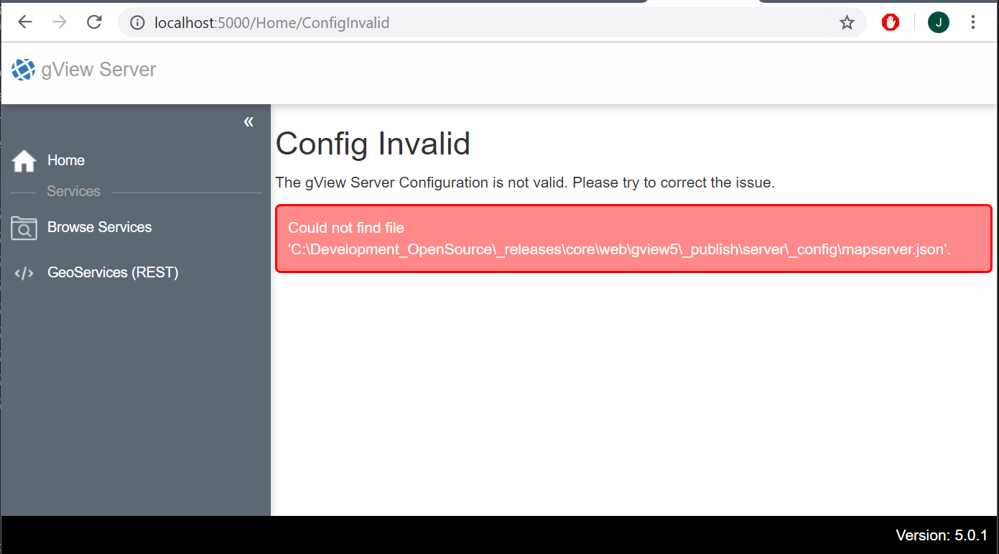
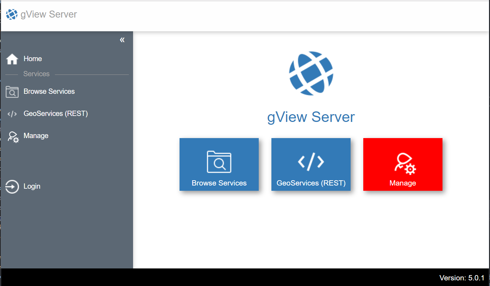
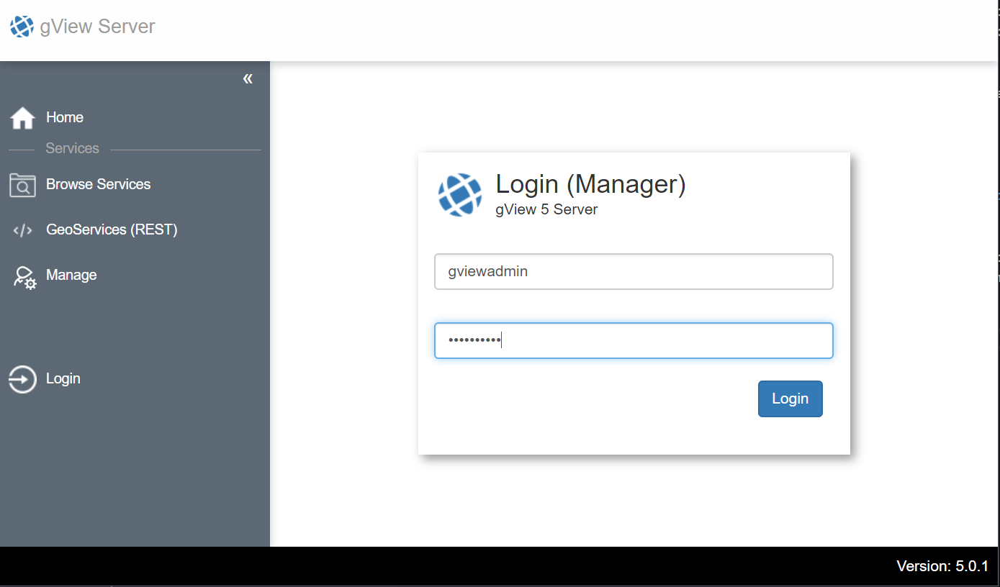
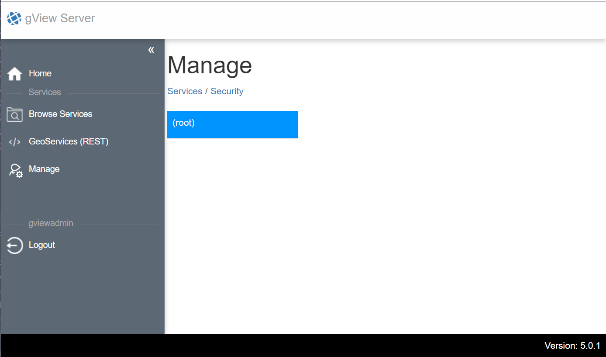

.. _server_postinstallation:

Postinstallation
================

Nach der Installation des gView Servers folgt die Postinstallation. Beim ersten Aufruf des Servers 
über den Browser wird eventuell folgende Meldung angezeigt:

Diese Fehlermeldung zeigt, dass die Konfiguration des Servers noch nicht korrekt ist.
Im Beispiel hier existiert die Datei ``_config/mapserver.json`` noch nicht. Die Form und Funktion 
dieser Datei wird im Abschnitt :ref:`config-server` gezeigt.

Nach erfolgreicher Konfiguration erscheint die Anwendung nach dem ersten Aufruf folgendermaßen:

Der rote Button ``Manage`` zeigt an, dass noch kein Administrator angelegt wurde. Der **gView Server**
benötigt einen Administrator Benutzer, der **Logins** und **Folder** (Verzeichnisse für Kartendienste)
anlegen darf.

Der erste Login legt den Administrator **nicht** an (sonst könnte jeder, der eine neue Installation
als Erster erreicht, sie übernehmen). Es gibt zwei Wege:

- **Umgebungsvariablen:** Sind ``GVIEW_ADMIN_USER`` und ``GVIEW_ADMIN_PASSWORD`` gesetzt
  (Umgebungsvariablen oder Werte in der ``mapserver.json``), legt der Server den Administrator
  beim Start an. Das ist der einfachste Weg für Docker und Kubernetes.
- **Setup-Code:** Sonst schreibt der Server beim Start einen einmaligen Setup-Code in sein Log
  (Konsole, ``docker logs``, ``stdout`` des IIS):

  .. code-block:: text

     No admin login exists. Open /manage/login and use this setup code to create the admin: ABCD-EFGH-JKLM

  Auf die rote Kachel klicken, den **Setup code**, einen Benutzernamen und zweimal das Passwort
  eingeben und **Create admin** klicken:

Ist das Passwort nicht stark genug, muss eventuell ein stärkeres Passwort angegeben werden.
Der Setup-Code gilt bis zum nächsten Neustart des Servers (ein Neustart schreibt einen neuen).
Falsche Codes werden wie Fehlversuche beim Login gesperrt. Die Setup-Seite ist nur aus den
Admin-Netzen erreichbar (standardmäßig die internen Netze), siehe :ref:`security-server`.
Nach erfolgreichem Anlegen des Administrators wechselt die Oberfläche in den **Manage** Bereich 
des gView Servers. Diese ist nur für den Administrator nach erfolgreicher Anmeldung sichtbar:

