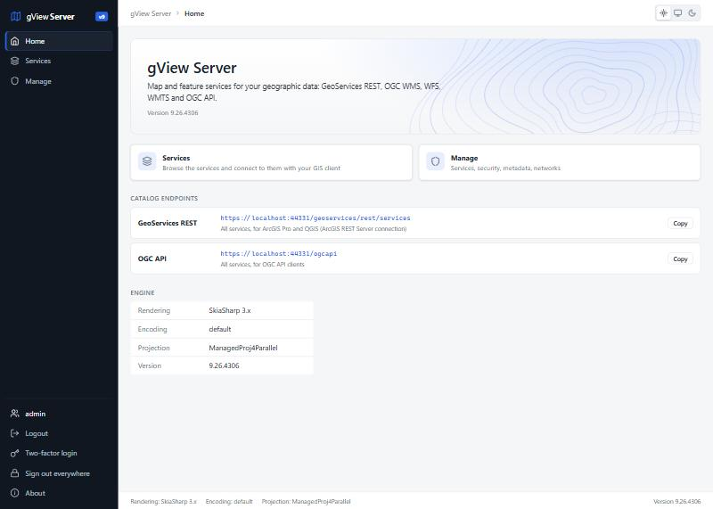
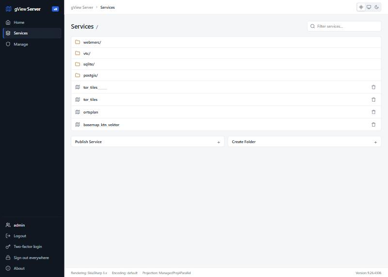
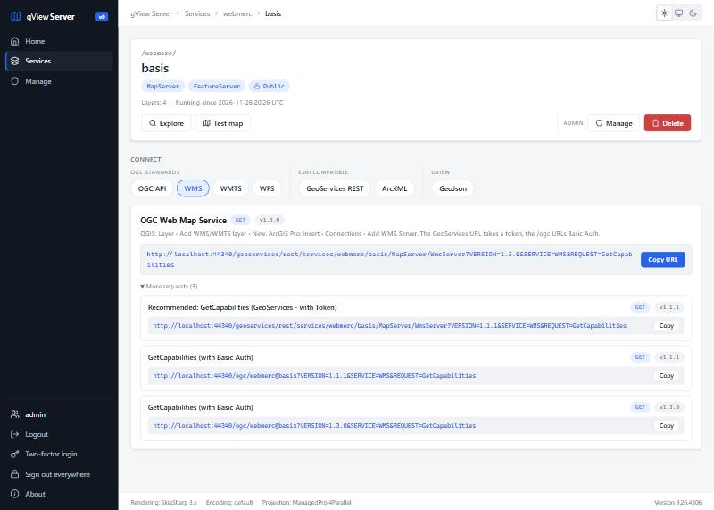
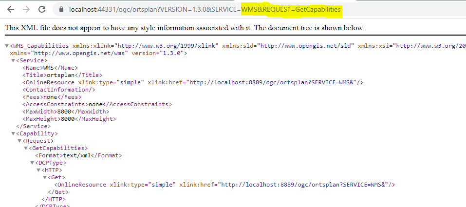

Services
========

In diesem Abschnitt wird gezeigt, wie die Dienste und Verzeichnisse von *gView MapServer* in der
Web-Oberfläche aufgelistet werden und wie man die Urls findet, mit denen ein Dienst in ein
*GIS-Programm* eingebunden wird.

Startseite
----------

Die Startseite führt zu den **Services** und zu **Manage** (Verwaltung, nur für Administratoren).
Darunter stehen die **Katalog-Endpunkte**: Urls, unter denen ein Client alle Dienste des Servers
findet, z. B. für eine *ArcGIS Server*-Verbindung (GeoServices REST) oder einen OGC-API-Client.
Mit **Copy** wird die Url in die Zwischenablage kopiert.

Dienste und Verzeichnisse
-------------------------

Unter **Services** (Kachel auf der Startseite bzw. *Sidebar*) werden die Verzeichnisse (mit
Ordner-Symbol und ``/`` am Ende) und die Dienste aufgelistet. Ein Klick auf ein Verzeichnis
öffnet es, über die Brotkrümel-Navigation oben geht es zurück. Mit **Filter services** lässt
sich die Liste nach dem Namen filtern.

.. note::
   Die Liste ist für jeden Anwender verfügbar (auch ohne Anmeldung). Es werden allerdings nur
   jene Dienste aufgelistet, für die der aktuelle Anwender berechtigt ist.

.. note::
   In diesem Beispiel ist der Administrator angemeldet. Daher stehen auch **Publish Service**,
   **Create Folder** und das Papierkorb-Symbol zum Löschen zur Verfügung. Das Veröffentlichen wird
   unter :ref:`publish-map-service-example` im Abschnitt :ref:`examples` behandelt.

.. note::
   In der Praxis sollten Dienste immer in Verzeichnissen organisiert werden und nicht im
   sogenannten **root** Bereich liegen.

Die Seite eines Dienstes
------------------------

Ein Klick auf einen Dienst öffnet seine Seite:

Oben stehen der Name, das Verzeichnis und die Eigenschaften des Dienstes: die Ressourcen für
GeoServices REST (**MapServer**, **FeatureServer**, **NetworkServer**), ob der Dienst
öffentlich (**Public**) oder gesichert (**Secured**) ist, die Anzahl der Layer und seit wann er
läuft. Darunter:

- **Explore**: der Dienst in den HTML-Seiten des GeoJson-Service – Layer, Felder und Abfragen
  direkt im Browser.
- **Test map**: der Dienst in einer kleinen Kartenanwendung, mit allen Requests im Überblick
  (siehe :ref:`server-testmap`). Ob der Button angezeigt wird, hängt von der Einstellung
  ``security:test-map`` ab.
- **Manage** und **Delete** (nur für Administratoren bzw. Benutzer mit Publish-Recht): der Dienst
  in der Verwaltung bzw. den Dienst löschen.

Verbinden
---------

Unter **Connect** stehen die Schnittstellen des Dienstes, gruppiert nach **OGC Standards**
(OGC API, WMS, WMTS, WFS), **Esri compatible** (GeoServices REST, ArcXML) und **gView**
(GeoJson). Für die gewählte Schnittstelle zeigt die Seite:

- die **empfohlene Url** zum Einbinden, mit **Copy URL**,
- einen Hinweis, wie die Url in gängigen Programmen eingebunden wird (z. B. **QGIS**,
  **ArcGIS Pro**),
- unter **More requests** weitere Urls, z. B. andere Versionen oder die Variante mit
  Basic Authentication unter ``/ogc``.

Klickt man auf eine Url, öffnet der Browser den Request, z. B. den *Capabilities Request* für
WMS:

Diese Url kann beispielsweise in **QGIS** als *WMS Layer* eingebunden werden.

Welche Schnittstellen angeboten werden, wird in der *Manage Web-Oberfläche* bei den
Berechtigungen für den Dienst oder das Verzeichnis festgelegt.
