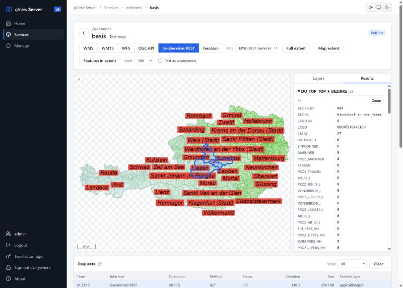

.. _server-testmap:

Testkarte
=========

Mit der **Testkarte** lässt sich ein Dienst direkt in der Web-Oberfläche von *gView MapServer*
ausprobieren, ohne ein GIS-Programm einzurichten. Sie verhält sich wie ein Client: Sie liest
zuerst die Capabilities einer Schnittstelle und schickt dann beim Verschieben, Zoomen und
Abfragen genau die Requests, die auch ein Programm wie **QGIS** oder eine Web-Anwendung schicken
würde. Jeder Request erscheint im **Request-Log** unter der Karte.

Aufgerufen wird die Testkarte auf der Seite eines Dienstes über den Button **Test map** neben
**Explore**. Wer den Button sieht, legt die Einstellung ``security:test-map`` fest
(siehe :ref:`server-testmap-access`); standardmäßig nur Administratoren.

Schnittstellen
--------------

Oben wird die Schnittstelle gewählt. Angeboten werden nur Schnittstellen, die für den Dienst
freigegeben sind; beim Wechsel bleibt der Kartenausschnitt erhalten.

- **WMS** (1.3.0): ``GetMap`` als ein Bild pro Ansicht, Klick = ``GetFeatureInfo`` mit wählbarem
  ``INFO_FORMAT``.
- **WMTS** (1.0.0): nur für Dienste mit Tile-Cache. Es wird immer ein Cache angezeigt (Auswahl in
  der Layerliste, dazu der **Style**), und zwar in der Projektion seines Kachel-Grids – die
  Kacheln werden im Browser nicht umprojiziert. Ein Klick fragt nichts ab.
- **WFS** (2.0.0): wie in einem Desktop-GIS werden bei jeder Ansicht die Features der
  angehakten Feature-Types per ``GetFeature`` geladen (höchstens **Limit** pro Type, als GeoJSON,
  ``SRSNAME`` und ``BBOX`` in URN-Schreibweise, siehe :ref:`server-wfs`) und als
  Vektoren gezeichnet. Ein Klick wählt geladene Features aus, ohne neuen Request.
- **OGC API**: Kartenbild über ``/map``, ein Klick fragt ``/collections/{id}/items`` rund um
  den Klickpunkt ab.
- **GeoServices REST**: ``export`` und ``identify`` des MapServers.
- **GeoJson**: ``map`` und ``identify`` des GeoJson-Service.

Karte und Abfragen
------------------

- **Layers**: die Layer aus den Capabilities zum Ein- und Ausschalten (bei Gruppen für alle
  Unter-Layer).
- **CRS**: die Karte startet in der Projektion des Dienstes. Die Auswahl bietet die weiteren
  Projektionen an, die die Schnittstelle unterstützt – so lässt sich die Umprojektion des
  Servers testen.
- **Full extent** und **Map extent** zoomen auf die Gesamtausdehnung bzw. den
  Ausgangsausschnitt aus den Capabilities. Beim nächsten Öffnen startet die Karte im zuletzt
  verwendeten Ausschnitt.
- **Results**: das Ergebnis eines Klicks als Attributtabelle pro Layer; Geometrien werden in
  der Karte hervorgehoben, **Zoom** zoomt auf ein Feature. HTML- und XML-Antworten werden nur als
  Text angezeigt.
- **Features in extent** (GeoServices REST, GeoJson, OGC API): fragt die angehakten Layer im
  aktuellen Ausschnitt ab, höchstens **Limit** (100 oder 1000) Features pro Layer. Ist das
  Limit erreicht, weist das Ergebnis darauf hin.

Ein neuer Ausschnitt bricht ein noch laufendes Kartenbild ab; solange gerendert wird, zeigt die
Karte die vergangenen Sekunden an.

Request-Log
-----------

Unter der Karte stehen alle Requests, der neueste oben: Zeit, Schnittstelle, Operation, Methode,
Status, Dauer, Größe und Content-Type. Fehler (auch die Fehler von GeoServices REST, die mit
HTTP 200 kommen) sind rot markiert, Auffälligkeiten mit ⚠ – z. B. wenn ein WFS die Geometrien
nicht im angefragten ``SRSNAME`` liefert. Die Kacheln einer WMTS-Ansicht stehen in einem Eintrag
mit einer Tabelle aller Kacheln.

Ein Klick auf einen Eintrag zeigt die vollständige Url, die Parameter als Tabelle und eine
Vorschau der Antwort, dazu:

- **Copy URL** – die Url, z. B. zum Einfügen in ein anderes Programm,
- **Copy curl** – den Request als ``curl``-Befehl,
- **Open in new tab** – den Request direkt im Browser.

Mit **Show** lässt sich das Log auf eine Operation einschränken, **Clear** leert es. Das Log
bleibt nur im Browser und hat höchstens 200 Einträge.

Anmeldung und Tokens
--------------------

Die Testkarte schickt die Requests mit der Anmeldung der Web-Oberfläche (Login-Cookie). In
Urls und im ``curl``-Befehl steht daher **nie** ein Token. Bei gesicherten Diensten enthält der
``curl``-Befehl stattdessen den Platzhalter ``Authorization: Bearer <TOKEN>``, den man durch ein
eigenes Token ersetzt.

Mit **Test as anonymous** werden alle Requests ohne Anmeldung geschickt. So sieht man, was ein
anonymer Client bekommt – z. B. ob ein Dienst wirklich öffentlich ist.

.. note::
   Verweisen die Capabilities auf einen anderen Host als die Seite (z. B. weil
   ``onlineresource-url`` auf die öffentliche Adresse zeigt, die Seite aber intern aufgerufen
   wurde), zeigt die Testkarte einen Hinweis und schickt die Requests trotzdem an diesen Server.
   Mit **Use URLs as advertised** werden die Urls unverändert verwendet, wie es ein Client von
   außen tun würde.

.. _server-testmap-access:

Wer die Testkarte verwenden darf
--------------------------------

Das legt ``security:test-map`` in ``_config/mapserver.json`` fest:

.. code-block:: javascript

   {
        "security": {
            // admin | users | all
            "test-map": "admin"
        }
   }

- ``admin`` (Standard, auch bei ungültigen Werten): nur Administratoren aus den Admin-Netzen
  (``security:manage:allowed-networks``).
- ``users``: zusätzlich angemeldete Benutzer.
- ``all``: zusätzlich anonyme Besucher bei öffentlichen Diensten.

In jedem Fall gilt die Testkarte nur für Dienste, auf die der Benutzer Zugriff hat. Sie schickt
keine anderen Requests, als der Benutzer auch direkt an die Dienste schicken könnte.

.. note::
   Mit ``all`` können anonyme Besucher über die Testkarte auch aufwändige Kartenbilder anfordern
   – genau wie über die Urls der Dienste selbst. Die Grenzen für Bildgröße und dpi gelten weiter;
   ein Rate Limit setzt man am besten im Reverse Proxy oder mit ``security:rate-limit``
   (siehe :ref:`security-server`).
