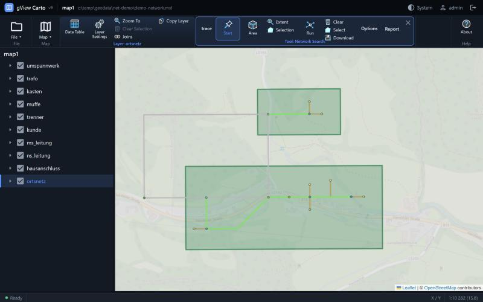
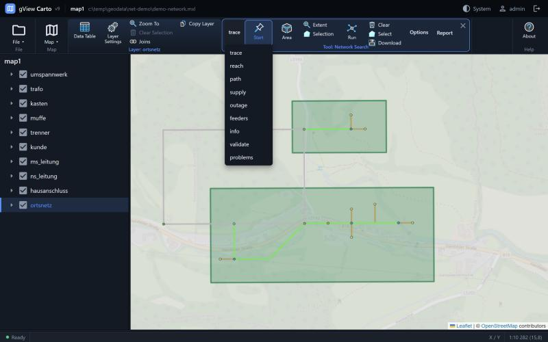
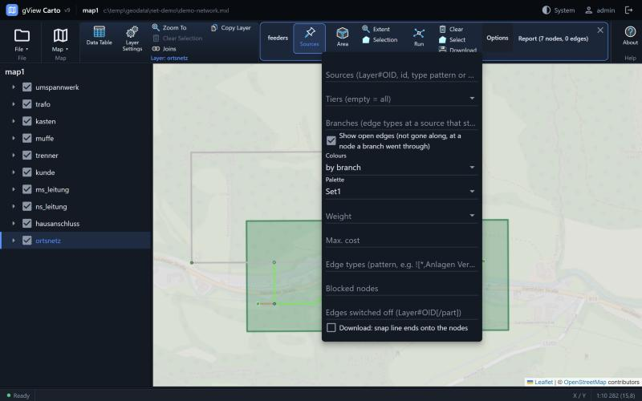
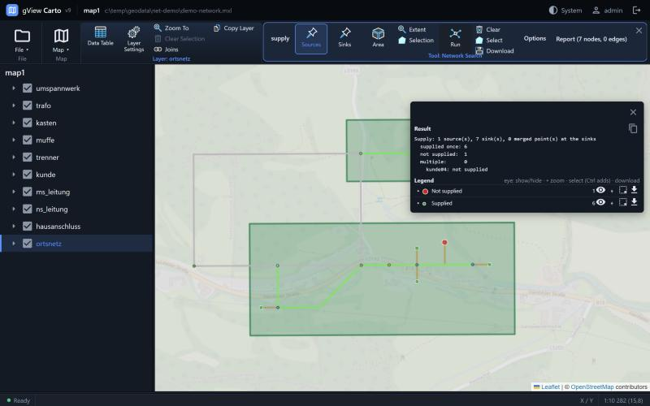
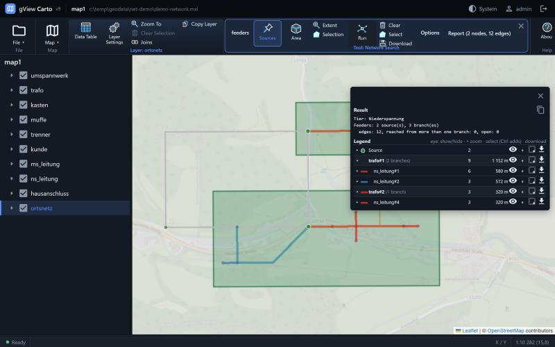
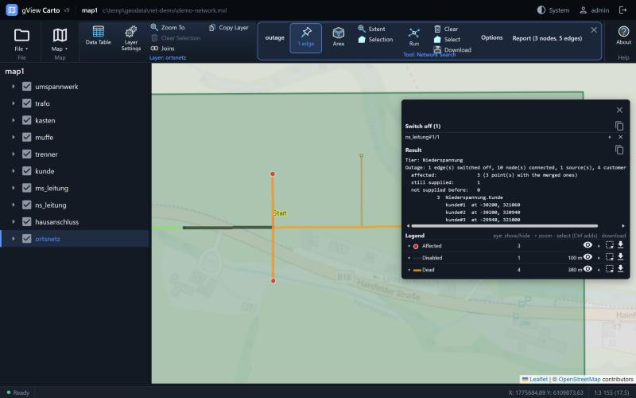
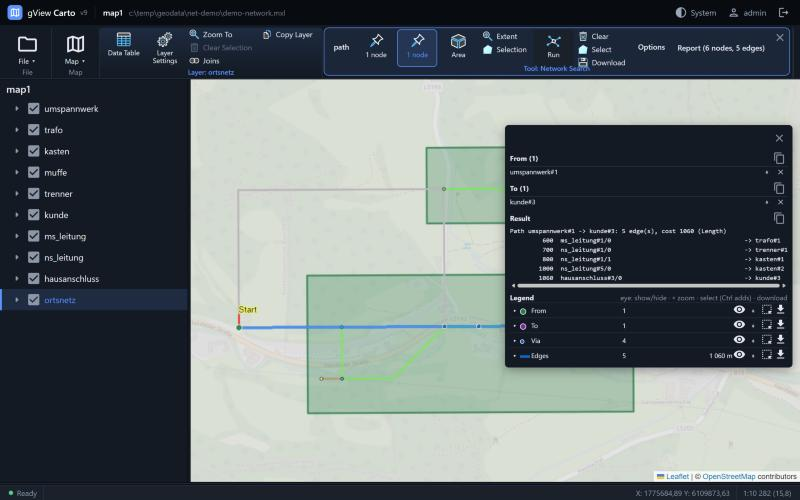
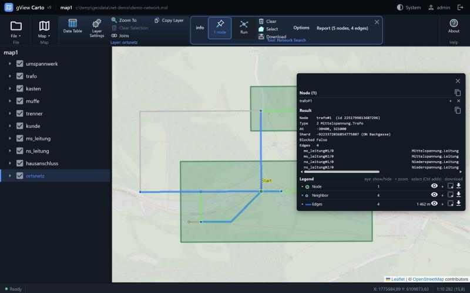
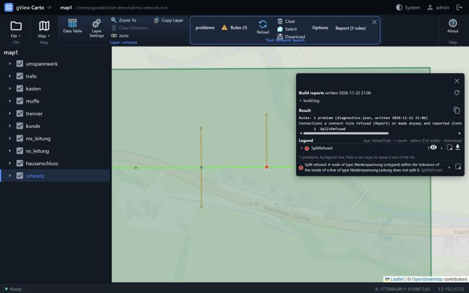

.. _carto-network-tools:

Netzwerk-Werkzeuge
==================

Auf einem gebauten Netzwerk (siehe :ref:`carto-network`) sucht das Werkzeug **Network Search** in *gView Carto*: Was hängt an
einem Knoten, welcher Weg ist der kürzeste, wer ist versorgt, was fällt aus, welcher Trafo und welcher Abzweig speisen eine
Leitung, und wo hat der Bau Probleme gemeldet. Die Beispiele verwenden das Beispielnetz von :ref:`carto-network`.

Das Werkzeug
------------

**Network Search** steht in der Werkzeugleiste unter **Tools**. Es öffnet eine eigene Leiste:

* links die **Operation** (hier *trace*),
* daneben die Knöpfe zum Anklicken in der Karte, je nach Operation **Start**, **From**/**To**, **Sources**/**Sinks** oder
  **Switch off**. Ein Klick in der Karte nimmt den nächsten Knoten; der Knopf zeigt danach die Anzahl (z. B. *1 node*),
* **Area** begrenzt die Suche auf einen Bereich: **Extent** nimmt den Kartenausschnitt, **Selection** die ausgewählten
  Flächen. Kanten über die Grenze werden nicht verfolgt,
* **Run** startet die Suche,
* **Clear** löscht das Ergebnis, **Select** übernimmt alle gefundenen Objekte als Auswahl der Layer, **Download** speichert
  das Ergebnis als GeoJSON,
* **Options** enthält die weiteren Einstellungen, **Report** öffnet das Ergebnisfenster wieder.

Liegen an der angeklickten Stelle mehrere Knoten (z. B. ein Trafo in der Mittel- und in der Niederspannung, wenn die Ebenen
getrennt gebaut sind), wählt die eingestellte Ebene den Knoten; ein weiterer Klick an dieselbe Stelle nimmt den nächsten.

Operationen
-----------

- **trace**: alles, was vom Start aus erreichbar ist, bis zu gesperrten Knoten (z. B. offenen Trennern).
- **reach**: wie *trace*, aber nur bis zu einer Entfernung bzw. Kosten (**Max. cost** unter **Options**).
- **path**: der kürzeste Weg von **From** nach **To**.
- **supply**: Welche Senken (z. B. Kunden) werden von den Quellen (z. B. dem Umspannwerk) erreicht?
- **outage**: Was fällt aus, wenn Knoten oder Leitungen abgeschaltet werden (**Switch off**)?
- **feeders**: Von welcher Quelle und über welchen Abzweig wird jede Leitung gespeist?
- **info**: die Daten eines Knotens und seiner Kanten.
- **validate**: prüft die Prüfregeln des Netzes (Tab **Rules**).
- **problems**: zeigt, was der Bau gemeldet hat.

Optionen
--------

- **Tiers**: nur in diesen Ebenen suchen (mehrere möglich, leer = alle). Mit einer Ebene gelten deren Quellen, Senken und
  gesperrte Knoten, und eine Suche hält an den Quellen der Ebene an.
- **Weight**, **Max. cost**: was die Kosten messen (Länge oder ein Gewicht des Netzes) und wo die Suche endet.
- **Edge types**: nur Kanten dieser Typen verfolgen, z. B. ``[Niederspannung,*]``.
- **Blocked nodes**: zusätzlich gesperrte Knoten, z. B. ``[*,Trenner]`` oder ``trenner#1``.
- **Edges switched off**: Leitungen, die für diese Suche aus sind, z. B. ``ns_leitung#4``.
- **Download: snap line ends onto the nodes**: Die Linien im GeoJSON enden genau auf den Knoten.

Je nach Operation kommen Felder dazu, bei *feeders* z. B. **Sources**, **Branches**, **Show open edges**, **Colours** und
**Palette**.

Ergebnis und Legende
--------------------

Das Ergebnis erscheint in der Karte und im Ergebnisfenster: oben die gewählten Knoten, darunter der Bericht (**Result**,
mit Knopf zum Kopieren) und die **Legende**. Die Legende zeigt jede Art des Ergebnisses (z. B. *Supplied*, *Not supplied*)
mit Farbe und Anzahl. Je Zeile:

- das **Auge** blendet die Art in der Karte aus und ein (bleibt beim nächsten Lauf derselben Operation erhalten),
- **+** zoomt auf die Objekte,
- **Auswählen** übernimmt die Objekte als Auswahl ihrer Layer, mit gedrückter **Strg**-Taste kommen sie zur Auswahl dazu,
- **Download** speichert nur diese Art als GeoJSON.

Versorgung
~~~~~~~~~~

*supply* ohne angeklickte Quellen nimmt die Quellen des Netzes (bzw. der Ebene). Hier sind sechs Kunden versorgt (grün),
``kunde#4`` nicht (rot, größer): Sein Hausanschluss endet auf einer Leitung, ohne angeschlossen zu sein. Das ist der
T-Stoß aus dem Beispiel, den der Bau gemeldet statt verbunden hat (siehe *problems* unten). Kunden, die über mehrere Wege
versorgt sind, erscheinen orange als *Multiple*.

Feeders: Trafo und Abzweig
~~~~~~~~~~~~~~~~~~~~~~~~~~

*feeders* färbt jede Leitung nach dem Abzweig (oder unter **Colours** nach der Quelle), über den sie gespeist wird. Ohne
angeklickte Quellen sind es die Quellen der Ebene, im Bild die beiden Trafos der Ebene Niederspannung. **Branches** legt
mit einem Typmuster fest, welche Kanten an einer Quelle einen Abzweig beginnen; leer ist jede Kante an der Quelle ein
Abzweig. Die Legende listet die Abzweige je Quelle mit Anzahl der Leitungen und Länge. Leitungen, die von mehr als einem
Abzweig erreicht werden (Ring, Doppeleinspeisung), sind rot (*Multiple*); mit **Show open edges** erscheinen Leitungen,
über die kein Abzweig gegangen ist (z. B. an einer Trennstelle), grau gestrichelt (*Open*).

Für ein ganzes Netz und zum Zurückschreiben in die Daten gibt es den Pipe-Knoten **Network Trace**.

Ausfall
~~~~~~~

*outage*: Mit **Switch off** eine Leitung oder einen Knoten anklicken, **Run**. Abgeschaltet (*Disabled*) ist dunkel, die
Leitungen ohne Versorgung (*Dead*) sind orange, die betroffenen Kunden (*Affected*) rot. Der Bericht nennt sie mit
Koordinaten.

Kürzester Weg
~~~~~~~~~~~~~

*path*: **From** und **To** anklicken, **Run**. Der Bericht listet die Kanten des Wegs mit den aufsummierten Kosten. Gesperrte
Knoten passiert der Weg nicht. Im Beispiel führt er durch ``trenner#1``, weil für den Trenner kein Schaltzustand
eingestellt ist (Layer Settings, **Normal switching state**); mit **Blocked nodes** lässt er sich für eine Suche sperren.

Info
~~~~

*info* zeigt zu einem Knoten die Id, den Typ, die Koordinaten, den Shard, ob er gesperrt ist, und alle Kanten mit ihren
Typen. Damit lässt sich prüfen, ob eine Leitung wirklich am Knoten angeschlossen ist.

Probleme des Baus
~~~~~~~~~~~~~~~~~

*problems* liest die Berichte des letzten Baus (Konflikte, Hinweise, Meldungen der Verbindungsregeln, Duplikate,
zusammengeführte Punkte) und zeigt sie als Punkte in der Karte. Die Kategorie wählt man links, **Reload** liest die
Berichte nach einem neuen Bau erneut. Ein Klick auf eine Zeile zoomt zum Problem, **Select** wählt die beteiligten Objekte
aus. Im Bild ist es der gemeldete T-Stoß aus dem Beispiel (*SplitRefused*). Unter **build.log** steht das Protokoll des
Baus.
