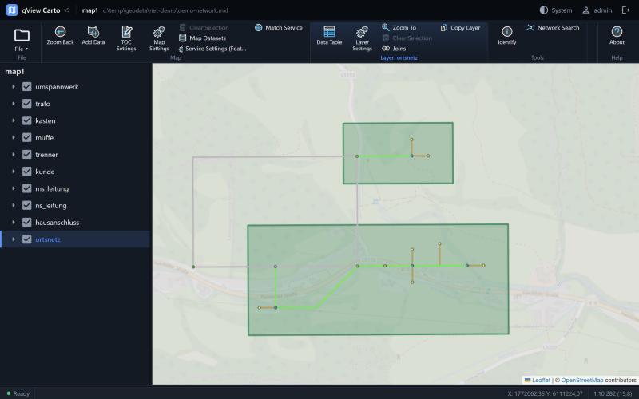
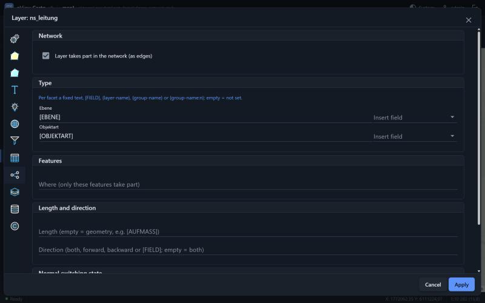
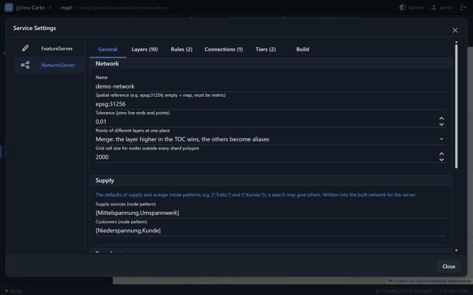
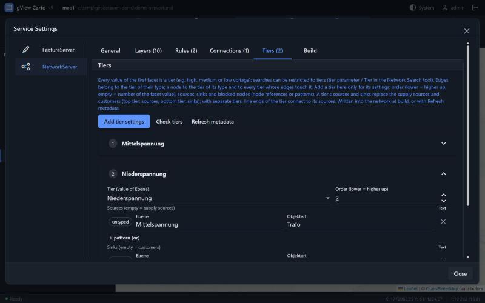
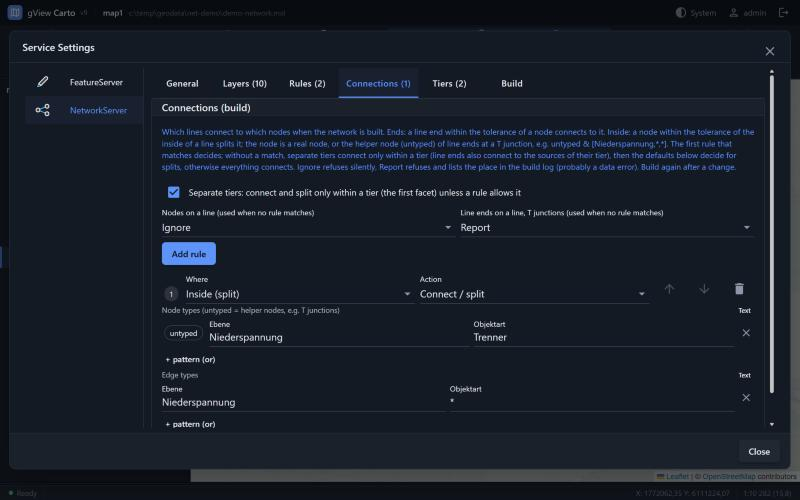
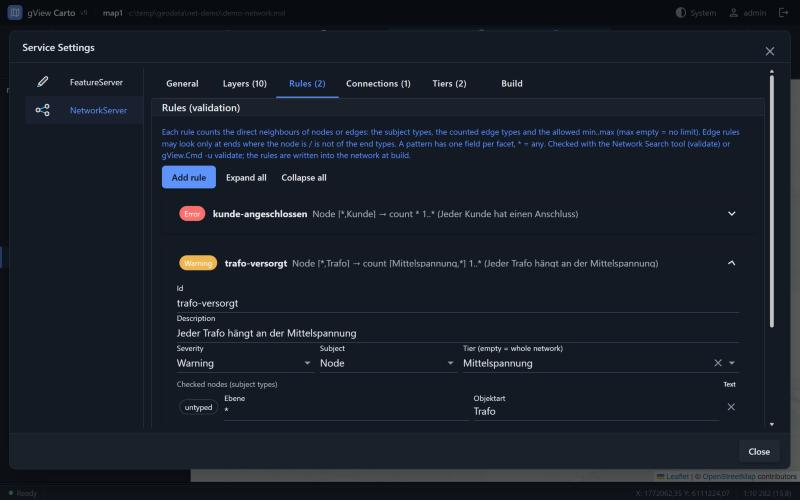
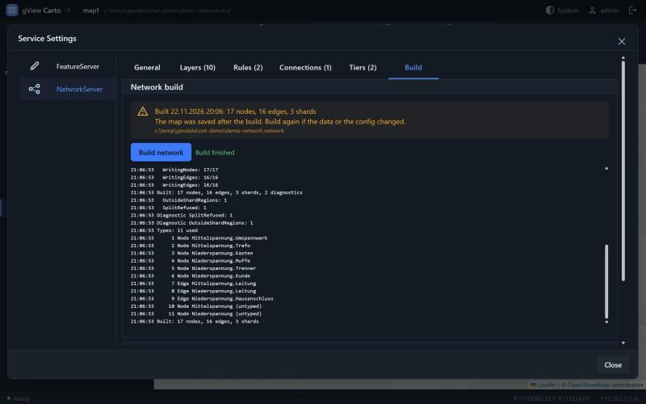
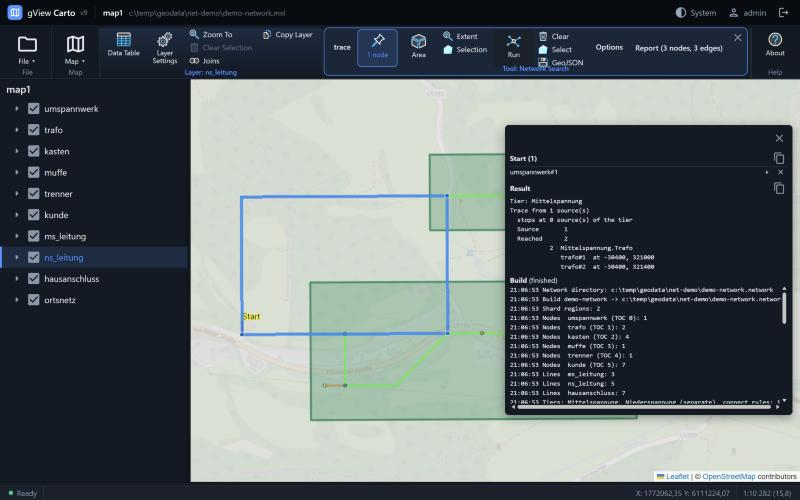

.. _carto-network:

Netzwerke erstellen
===================

Aus den Punkt- und Linien-Layern einer Karte baut *gView Carto* ein Netzwerk: einen Graphen aus Knoten und Kanten,
auf dem der **NetworkServer** des Dienstes sucht (Trace, kürzester Weg, Versorgung, Ausfall, Prüfregeln). Diese Seite
zeigt die Schritte in Carto an einem kleinen Beispielnetz: ein Umspannwerk, drei Mittelspannungsleitungen, zwei Trafos
und dahinter ein Niederspannungsnetz mit Kästen, einem Trenner, Hausanschlüssen und Kunden. Die Konfiguration im Detail
beschreibt :ref:`network-service-administration`.

Im Beispiel liegt eine Niederspannungsmuffe auf einem Stützpunkt einer Mittelspannungsleitung, und ein Hausanschluss endet
auf einer Niederspannungsleitung (T-Stoß). Beides kommt in echten Daten oft vor, wenn die Ebenen von verschiedenen
Abteilungen gepflegt werden; Schritt 3 zeigt, wie man damit umgeht.

1. Layer ins Netzwerk aufnehmen
-------------------------------

Für jeden Layer, der zum Netz gehört: Kontextmenü des Layers, **Layer Settings**, Seite **Network**.

* **Layer takes part in the network**: Punkt-Layer werden Knoten, Linien-Layer Kanten, ein Polygon-Layer kann die
  **Shards** (z. B. Ortsnetze) liefern.
* **Type**: je Facette eine Vorlage, aus der der Typ jedes Objekts entsteht: ein fester Text, ein Feld ``[EBENE]``,
  ``{layer-name}``, ``{group-name}`` (die Gruppe des Layers) oder ``{group-name:n}``. **Die erste Facette ist die Ebene**
  (Tier), z. B. Mittelspannung oder Niederspannung: Wer je Ebene eine Gruppe im Inhaltsverzeichnis hat, nimmt dort
  ``{group-name}``.
* **Where**, Länge, Richtung und der Normalschaltzustand (z. B. ein Feld, dessen Wert einen Trenner sperrt) sind optional.

Alternativ übernimmt **Service Settings**, **NetworkServer**, Tab **Layers**, **Add all point and line layers** alle Layer
auf einmal.

2. Grundeinstellungen
---------------------

**Service Settings** (in der Werkzeugleiste **Map**), links **NetworkServer**, Tab **General**:

* **Spatial reference**: das metrische Koordinatensystem, in dem gebaut wird (leer: das der Karte).
* **Tolerance**: Linienenden und Punkte, die näher beieinanderliegen, werden ein Knoten (Standard 0,01).
* **Points of different layers at one place**: ein Fehler, oder der Layer weiter oben im Inhaltsverzeichnis gewinnt und die
  anderen werden Aliase (z. B. ein Kunde, der auf einem Kasten gezeichnet ist).
* **Supply**: die Standard-Quellen und -Kunden für Versorgung und Ausfall, als Typmuster, z. B. ``[Mittelspannung,Umspannwerk]``.
* **Type facets** und **Weights**: die Facetten (Ebene, Objektart, …) und weitere Gewichte neben der Länge.

3. Ebenen und Verbindungen
--------------------------

Jeder Wert der ersten Facette ist eine **Ebene** (Tier). Im Tab **Tiers** erhält eine Ebene ihre Einstellungen: Rang,
Quellen, Senken und gesperrte Knoten. Die Quellen der Niederspannung sind die Trafos der Mittelspannung.

Im Tab **Connections** wird festgelegt, was beim Bauen verbunden und geteilt wird:

* **Separate tiers**: verbunden und geteilt wird nur innerhalb einer Ebene. Die Niederspannungsmuffe auf der
  Mittelspannungsleitung teilt sie dann nicht mehr; Niederspannungsleitungen schließen an die Trafos an, weil diese
  Quellen ihrer Ebene sind.
* **Nodes on a line**, **Line ends on a line (T junctions)**: was gilt, wenn keine Regel passt. Im Beispiel teilt kein
  Knoten eine Linie (*Ignore*), T-Stöße werden gemeldet (*Report*).
* **Regeln**: Die erste passende Regel gewinnt. Hier darf ein Trenner der Niederspannung eine Niederspannungsleitung teilen.
  Der Schalter **untyped** einer Zeile wählt die Hilfsknoten (Linienenden ohne Punkt), z. B. für Regeln zu T-Stößen;
  **Text** zeigt das Muster als Text (``&`` und, ``!`` nicht).

Die Felder der Muster schlagen die Werte der Facetten vor. Wie die Entscheidung im Einzelnen fällt, steht unter
:ref:`network-service-connect`.

4. Prüfregeln
-------------

Im Tab **Rules** stehen Regeln, die Topologiefehler finden: Eine Regel zählt die direkten Nachbarn von Knoten oder Kanten
und vergleicht die Anzahl mit Min und Max, auf Wunsch nur in einer Ebene.

Geprüft wird mit dem Werkzeug **Network Search** (Operation *validate*) oder mit ``gView.Cmd -u validate``.

5. Bauen
--------

Tab **Build**, **Build network**. Die Karte muss gespeichert sein: Das Netzwerk wird neben ihr abgelegt
(``{Karte}.network``). Das Log zeigt die Anzahl der Knoten, Kanten und Shards, die Hinweise (z. B. ``SplitRefused`` für den
gemeldeten T-Stoß) und die verwendeten Typen. ``conflicts.json`` im Netzwerkverzeichnis listet Konflikte, wenn der Bau
abbricht.

Unter **JSON (gView.Cmd)** lässt sich die Konfiguration exportieren und importieren, z. B. um mit
``gView.Cmd --command Network -u build`` nachts zu bauen.

6. Suchen
---------

Das Werkzeug **Network Search** (Werkzeugleiste **Tools**) sucht auf dem gebauten Netz: Operation wählen (trace, reach,
path, supply, outage, validate), Start mit **Start** in der Karte anklicken, **Run**. Unter **Options** schränkt **Tiers** die
Suche auf Ebenen ein; ein Bereich (**Area**) begrenzt sie räumlich.

Das Bild zeigt einen Trace vom Umspannwerk auf der Ebene Mittelspannung: Er erreicht die beiden Trafos, die Muffe der
Niederspannung bleibt außen vor. Liegen an der angeklickten Stelle mehrere Knoten (getrennte Ebenen), wählt die Ebene den
Knoten; ein weiterer Klick an dieselbe Stelle nimmt den nächsten.

7. Veröffentlichen
------------------

Wird die Karte als Dienst veröffentlicht, steht das Netzwerk als **NetworkServer** des Dienstes bereit, sobald es am
Speicherort des Servers liegt (Build in der Server-Verwaltung, gView.Cmd oder kopiert). Zugriff, Speicherort und die
REST-Operationen beschreibt :ref:`network-service-administration`.
