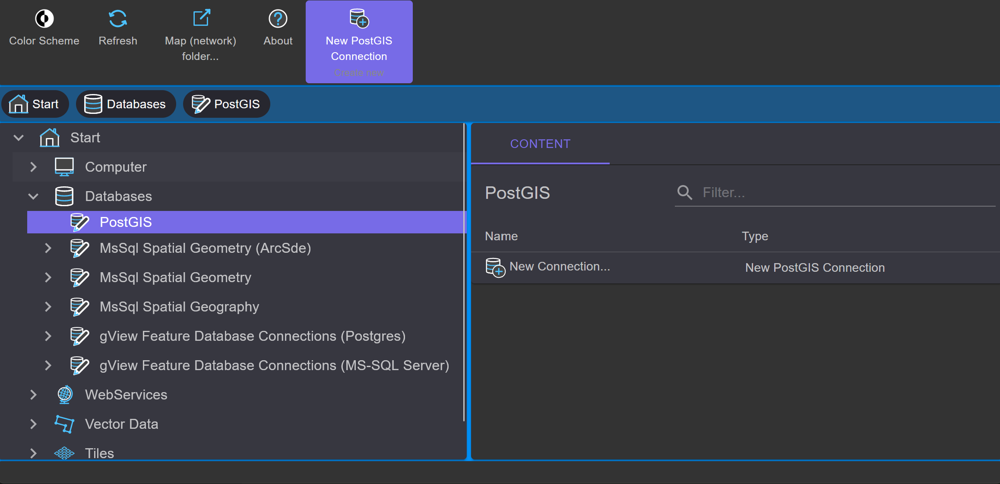
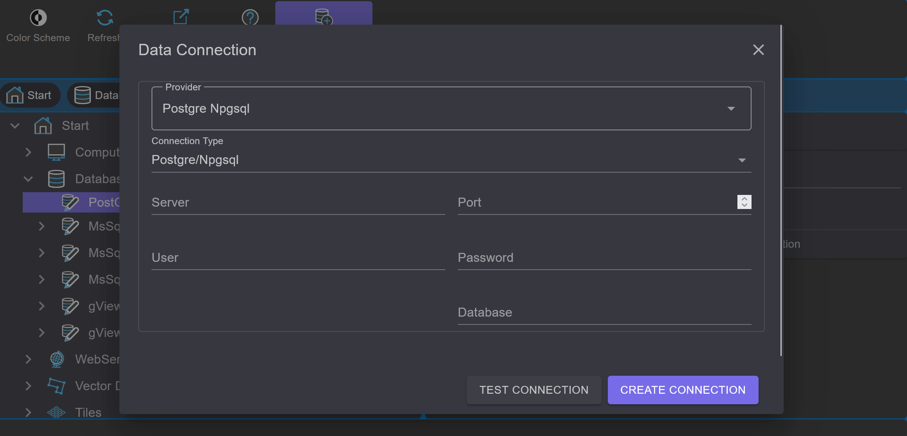

Daten(bank) Verbindungen
========================

Mit *gView.DataExplorer* können Verbindungen zu GeoDaten Quellen verwaltet und die Daten auf einfache Weise 
visualisiert werden.

File basierte Datenquellen können einfach angezeigt werden, indem man zum jeweiligen Verzeichnis im Filesystem navigiert.

Bei Datenbanken müssen zuerst die Verbindungen erzeugt werden. Hier soll beispielhaft gezeigt werden, wie die Verbindung zu 
einer PostGIS Datenbank erstellt wird.

.. note::
   Verbindungen, die im *gView.DataExplorer* erzeugt werden, stehen auch in *gView.Carto* beim Einfügen von Daten zur Verfügung.

PostGIS Datenbanken werden über den Knoten ``Databases`` eingebunden:

Unter ``PostGIS`` werden alle bestehenden Verbindungen aufgelistet. Mit ``New Connection`` kann eine neue Verbindung angelegt werden:

Nach Eingabe der Verbindungsparameter kann vor dem Anlegen noch mit ``Test Connection`` überprüft werden,
ob eine Verbindung möglich ist. Nach der Bestätigung des Dialogs mit ``OK`` wird die Verbindung angelegt und erscheint in der 
Liste. Durch einen Doppelklick wird die Verbindung geöffnet und die Layer in der Datenbank aufgelistet.

Über die Werkzeuge im Kontextbereich der Werkzeugleiste kann eine Verbindung umbenannt oder gelöscht 
werden. Mit dem Button ``Connection String...`` können die Verbindungsparameter nachträglich geändert werden.

.. note::
   Werden mit *gView Carto* Daten über eine Datenbankverbindung eingebunden, werden alle Verbindungsparameter in die 
   MXL Datei gespeichert. Ein nachträgliches Ändern der Verbindungsparameter im *gView DataExplorer* wirkt sich nicht auf 
   bestehende, bereits erstellte *gView Carto* Karten aus.

.. _dataexplorer-cog:

Cloud Optimized GeoTIFF (COG) über HTTP
---------------------------------------

GeoTIFF- und COG-Dateien auf einem Webserver oder in einem Object Store (S3, Azure Blob Storage) können direkt
über ihre URL eingebunden werden, ohne sie herunterzuladen. Gelesen werden mit Range-Requests nur die Teile, die
eine Karte braucht. Die Verbindungen liegen unter ``WebServices`` im Knoten ``Cloud Optimized GeoTIFF (COG)``.

Mit ``New Connection...`` öffnet sich ein Dialog, in dem eine oder mehrere URLs eingegeben werden, eine pro Zeile.
Beim Bestätigen mit ``OK`` wird jede URL geöffnet und geprüft: Gültige Zeilen werden mit Größe, Anzahl der Bänder,
Overviews und Koordinatensystem angezeigt, fehlerhafte mit der Fehlermeldung (z. B. Datei nicht gefunden, kein
GeoTIFF, Server ohne Range-Unterstützung). Der Dialog schließt erst, wenn alle Zeilen gelesen werden können.
Jede URL wird zu einer eigenen Verbindung; ihr Name ist der Dateiname, bei gleichen Dateinamen mit dem
Verzeichnis davor (z. B. ``S2B_33UXP_20240824_0_L2A/TCI.tif``).

Über die Werkzeuge im Kontextbereich kann eine Verbindung umbenannt oder gelöscht werden; mit ``URL`` lässt sich
die Adresse ändern, z. B. für eine erneuerte vorsignierte URL. Eine Verbindung kann wie eine Rasterdatei in eine
*gView Carto* Karte übernommen werden; in der MXL-Datei wird die URL wie ein Dateiname gespeichert.

.. note::
   Unterstützt wird nur GeoTIFF/COG; andere Rasterformate werden über HTTP abgelehnt. Timeout, Wiederholungen und
   zusätzliche Header (z. B. ein API-Key) werden global im Abschnitt ``rasternet`` konfiguriert
   (siehe :ref:`Konfiguration gView.Server, Abschnitt rasternet <config-rasternet>`). Geschützte Dateien werden über vorsignierte bzw. SAS-URLs eingebunden.

Zum Ausprobieren eignen sich öffentliche COGs, z. B. aus den *Open Data* Beständen von AWS:

- Copernicus DEM (Höhenmodell, Float32): ``https://copernicus-dem-30m.s3.amazonaws.com/Copernicus_DSM_COG_10_N47_00_E016_00_DEM/Copernicus_DSM_COG_10_N47_00_E016_00_DEM.tif``
- Sentinel-2 Echtfarbbild (RGB): ``https://sentinel-cogs.s3.us-west-2.amazonaws.com/sentinel-s2-l2a-cogs/33/U/XP/2024/8/S2B_33UXP_20240824_0_L2A/TCI.tif``
