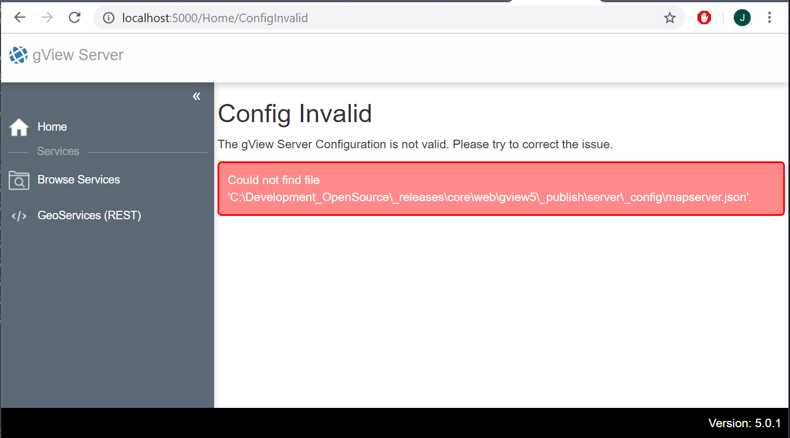
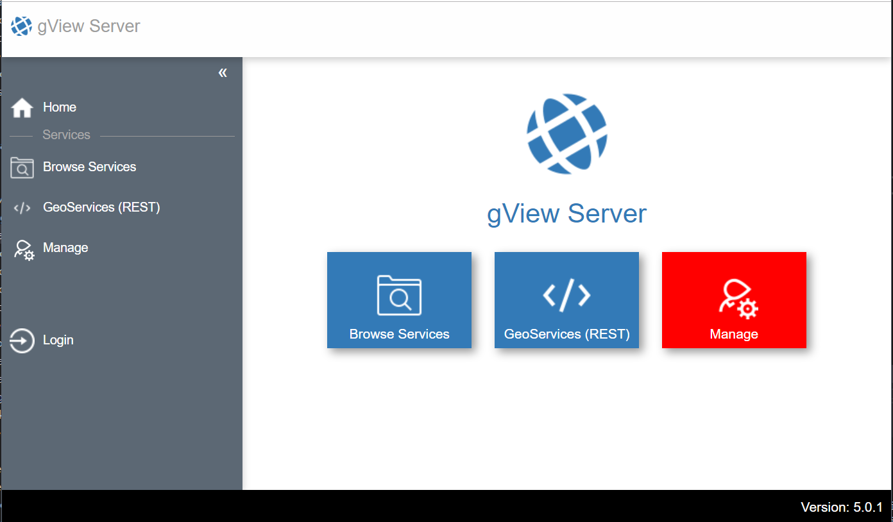
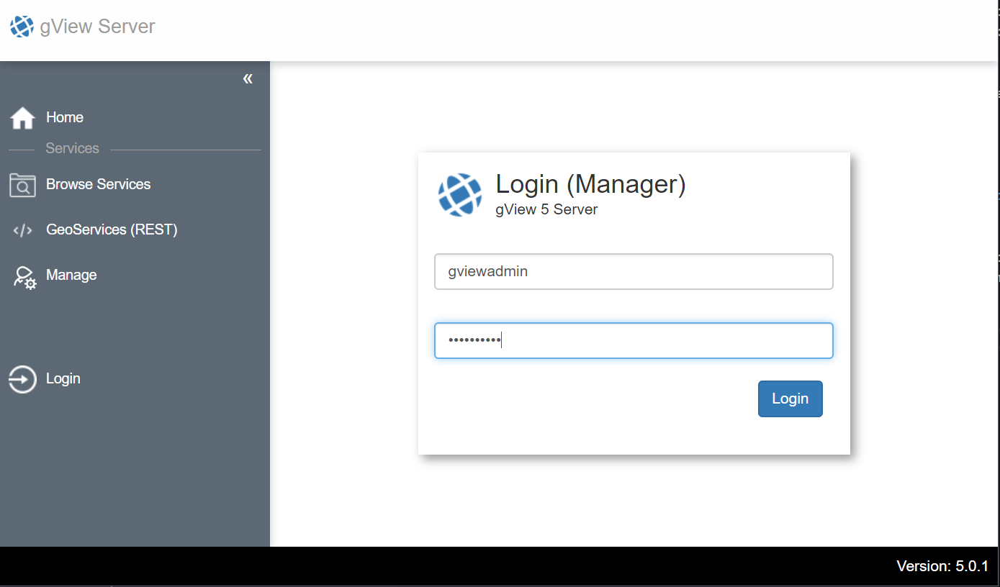
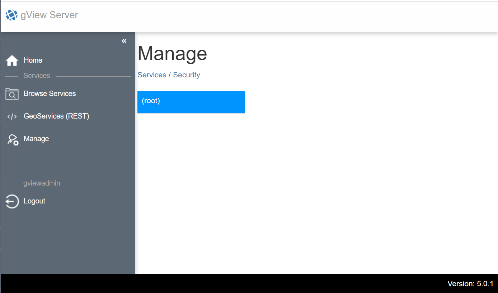

.. _server_postinstallation:

Post-installation
=================

After installing the gView Server, post-installation follows. When the server is first accessed 
via the browser, the following message may appear:

This error message indicates that the server configuration is not yet correct.
In this example, the file ``_config/mapserver.json`` does not yet exist. The form and function 
of this file is shown in the section :ref:`config-server`.

After successful configuration, the application will look like this after the first launch:

The red ``Manage`` button indicates that no administrator has been created yet. The **gView Server**
requires an administrator user who can create **Logins** and **Folders** (directories for map services).

The first login does **not** create the administrator (otherwise anyone who reaches a fresh
installation first could take it over). There are two ways:

- **Environment variables:** if ``GVIEW_ADMIN_USER`` and ``GVIEW_ADMIN_PASSWORD`` are set
  (environment variables or values in ``mapserver.json``), the server creates the administrator
  at startup. This is the easiest way for Docker and Kubernetes.
- **Setup code:** otherwise the server writes a one-time setup code to its log at startup
  (console, ``docker logs``, ``stdout`` of IIS):

  .. code-block:: text

     No admin login exists. Open /manage/login and use this setup code to create the admin: ABCD-EFGH-JKLM

  Click on the red tile, enter the **Setup code**, a username and the password twice and
  click **Create admin**:

If the password is not strong enough, a stronger password may need to be specified.
The setup code is valid until the server is restarted (a restart writes a new one). Wrong codes
are locked out like failed logins. The setup page is only reachable from the admin networks
(by default the internal networks), see :ref:`security-server`.
After the administrator has been successfully created, the interface switches to the **Manage** area 
of the gView Server. This is only visible to the administrator after successful login:

