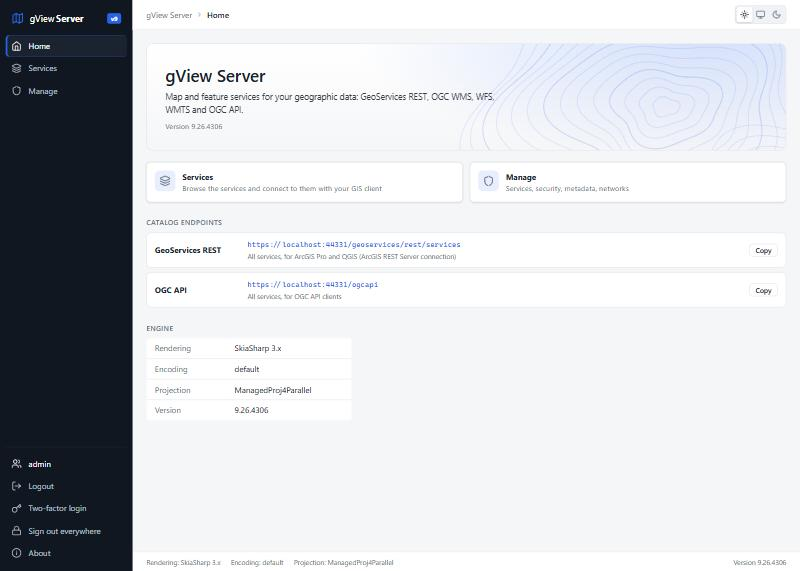
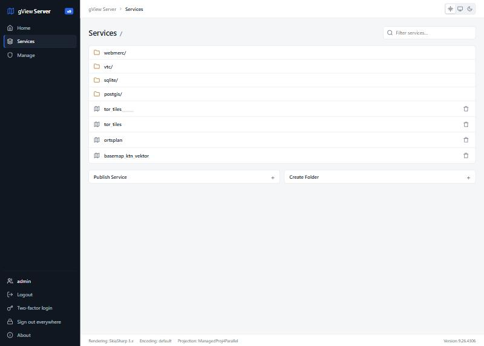
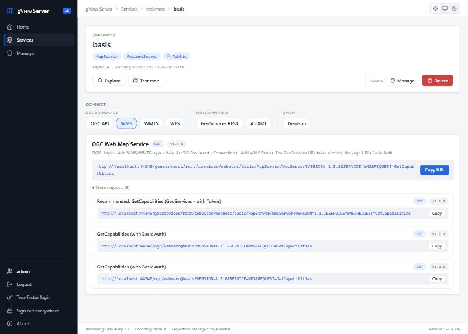
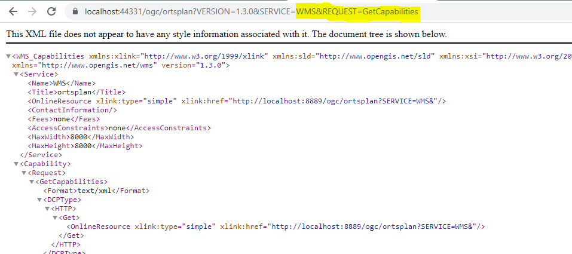

Services
========

This section shows how the services and folders of *gView MapServer* are listed in the web
interface and how to find the urls to add a service to a *GIS program*.

Home page
---------

The home page leads to the **Services** and to **Manage** (administration, administrators only).
Below are the **catalog endpoints**: urls where a client finds all services of the server, e.g.
for an *ArcGIS Server* connection (GeoServices REST) or an OGC API client. **Copy** copies the url
to the clipboard.

Services and folders
--------------------

**Services** (tile on the home page or *Sidebar*) lists the folders (with a folder icon and a
trailing ``/``) and the services. Click a folder to open it, the breadcrumb at the top leads
back. **Filter services** filters the list by name.

.. note::
   The list is available to every user (even without logging in). However, only the services
   the current user is authorized for are listed.

.. note::
   In this example the administrator is logged in. That is why **Publish Service**,
   **Create Folder** and the trash bin icon to delete a service are available. Publishing is
   covered in :ref:`publish-map-service-example` in the section :ref:`examples`.

.. note::
   In practice, services should always be organized in folders and not in the so-called
   **root** area.

The page of a service
---------------------

Click a service to open its page:

At the top are the name, the folder and the properties of the service: the GeoServices REST
resources (**MapServer**, **FeatureServer**, **NetworkServer**), whether the service is public
(**Public**) or secured (**Secured**), the number of layers and since when it has been running.
Below:

- **Explore**: the service in the HTML pages of the GeoJson service – layers, fields and queries
  right in the browser.
- **Test map**: the service in a small map application, with an overview of all requests (see
  :ref:`server-testmap`). Whether the button is shown depends on the setting
  ``security:test-map``.
- **Manage** and **Delete** (administrators and users with the publish permission only): the
  service in the administration, or delete the service.

Connect
-------

**Connect** lists the interfaces of the service, grouped into **OGC Standards** (OGC API, WMS,
WMTS, WFS), **Esri compatible** (GeoServices REST, ArcXML) and **gView** (GeoJson). For the chosen
interface the page shows:

- the **recommended url** to add the service, with **Copy URL**,
- a hint how to add the url in common programs (e.g. **QGIS**, **ArcGIS Pro**),
- under **More requests** further urls, e.g. other versions or the variant with Basic
  Authentication under ``/ogc``.

Clicking a url opens the request in the browser, e.g. the *capabilities request* for WMS:

This url could, for example, be added to **QGIS** as a *WMS Layer*.

Which interfaces are offered is set in the *Manage web interface* in the permissions for the
service or folder.
