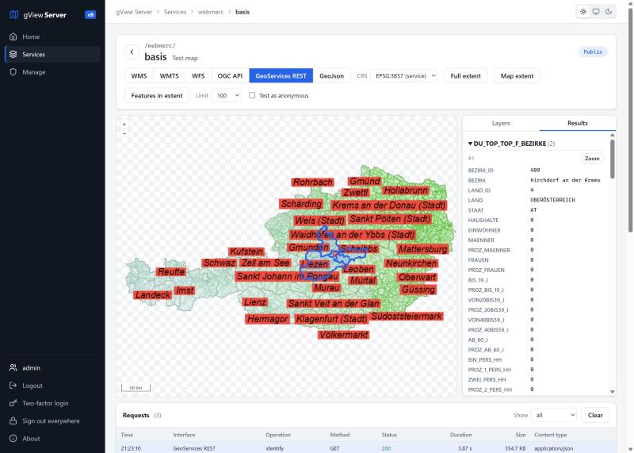

.. _server-testmap:

Test Map
========

The **test map** lets you try a service right in the web interface of *gView MapServer*,
without setting up a GIS program. It behaves like a client: it reads the capabilities of an
interface first, then sends exactly the requests a program like **QGIS** or a web application
would send when panning, zooming and querying. Every request shows up in the **request log**
below the map.

Open the test map from the page of a service with the **Test map** button next to **Explore**.
Who sees the button is set with ``security:test-map`` (see :ref:`server-testmap-access`); by
default only administrators.

Interfaces
----------

Choose the interface at the top. Only the interfaces enabled for the service are offered; the
map extent is kept when switching.

- **WMS** (1.3.0): ``GetMap`` as one image per view, a click sends ``GetFeatureInfo`` with a
  choice of ``INFO_FORMAT``.
- **WMTS** (1.0.0): only for services with a tile cache. One cache is shown at a time (choose it
  in the layer list, plus its **Style**), in the projection of its tile grid – the tiles are not
  reprojected in the browser. A click does not query anything.
- **WFS** (2.0.0): like in a desktop GIS, every view loads the features of the checked feature
  types with ``GetFeature`` (at most **Limit** per type, as GeoJSON, ``SRSNAME`` and ``BBOX`` in
  URN notation, see :ref:`server-wfs`) and draws them as vectors. A click
  selects loaded features without a new request.
- **OGC API**: map image from ``/map``, a click queries ``/collections/{id}/items`` around the
  clicked point.
- **GeoServices REST**: ``export`` and ``identify`` of the MapServer.
- **GeoJson**: ``map`` and ``identify`` of the GeoJson service.

Map and queries
---------------

- **Layers**: the layers from the capabilities to switch on and off (for groups all their
  sub layers).
- **CRS**: the map starts in the projection of the service. The selector offers the other
  projections the interface supports – to test the reprojection of the server.
- **Full extent** and **Map extent** zoom to the full extent and the initial extent from the
  capabilities. The next time the map starts with the extent last used.
- **Results**: the result of a click as an attribute table per layer; geometries are
  highlighted in the map, **Zoom** zooms to a feature. HTML and XML responses are shown as text
  only.
- **Features in extent** (GeoServices REST, GeoJson, OGC API): queries the checked layers in the
  current extent, at most **Limit** (100 or 1000) features per layer. The result tells when the
  limit was reached.

A new extent aborts a map image still being rendered; while the server renders, the map shows
the seconds passed.

Request log
-----------

Below the map are all requests, the newest at the top: time, interface, operation, method,
status, duration, size and content type. Errors (also the errors of GeoServices REST that come
with HTTP 200) are marked red, anything unusual with ⚠ – e.g. when a WFS does not return the
geometries in the requested ``SRSNAME``. The tiles of a WMTS view are one entry with a table of
all tiles.

Click an entry to see the full url, the parameters as a table and a preview of the response,
and:

- **Copy URL** – the url, e.g. to paste it into another program,
- **Copy curl** – the request as a ``curl`` command,
- **Open in new tab** – the request right in the browser.

**Show** limits the log to one operation, **Clear** empties it. The log stays in the browser and
keeps at most 200 entries.

Login and tokens
----------------

The test map sends the requests with the login of the web interface (login cookie). That is why
urls and the ``curl`` command **never** contain a token. For secured services the ``curl``
command contains the placeholder ``Authorization: Bearer <TOKEN>`` instead; replace it with a
token of your own.

**Test as anonymous** sends all requests without the login. This shows what an anonymous client
gets – e.g. whether a service is really public.

.. note::
   When the capabilities point to another host than the page (e.g. because
   ``onlineresource-url`` is the public address but the page was opened internally), the test map
   shows a notice and still sends the requests to this server. With **Use URLs as advertised**
   the urls are used unchanged, as a client outside would do.

.. _server-testmap-access:

Who may use the test map
------------------------

This is set with ``security:test-map`` in ``_config/mapserver.json``:

.. code-block:: javascript

   {
        "security": {
            // admin | users | all
            "test-map": "admin"
        }
   }

- ``admin`` (default, also for invalid values): only administrators from the admin networks
  (``security:manage:allowed-networks``).
- ``users``: also logged in users.
- ``all``: also anonymous visitors of public services.

In any case the test map only works for services the user has access to. It sends no other
requests than the user could send to the services directly.

.. note::
   With ``all`` anonymous visitors can request expensive map images through the test map – just
   as through the urls of the services themselves. The limits for image size and dpi still apply;
   a rate limit is best set in the reverse proxy or with ``security:rate-limit`` (see
   :ref:`security-server`).
