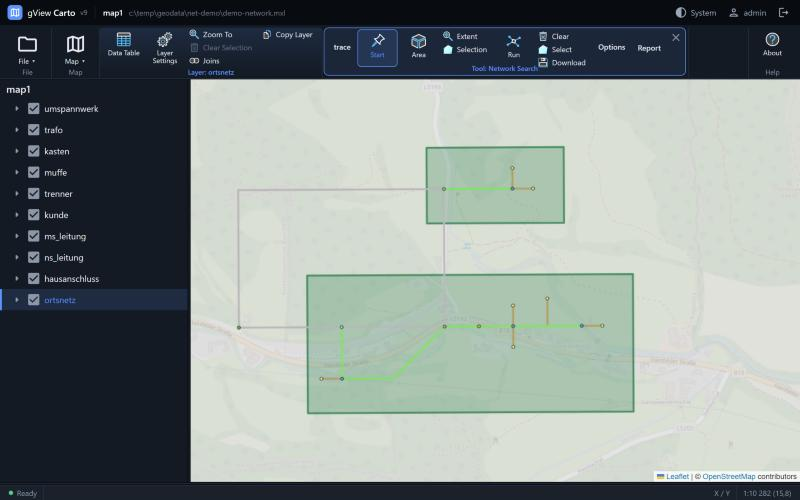
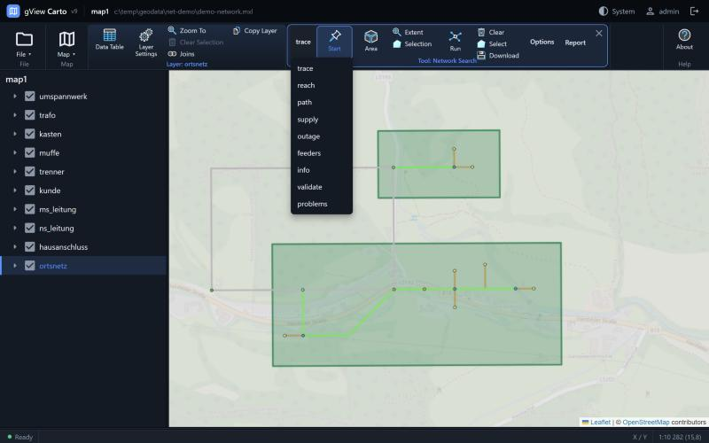
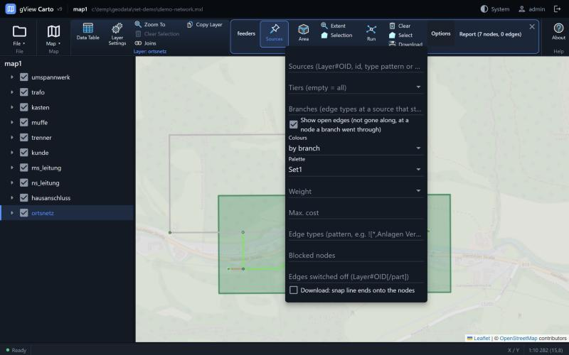
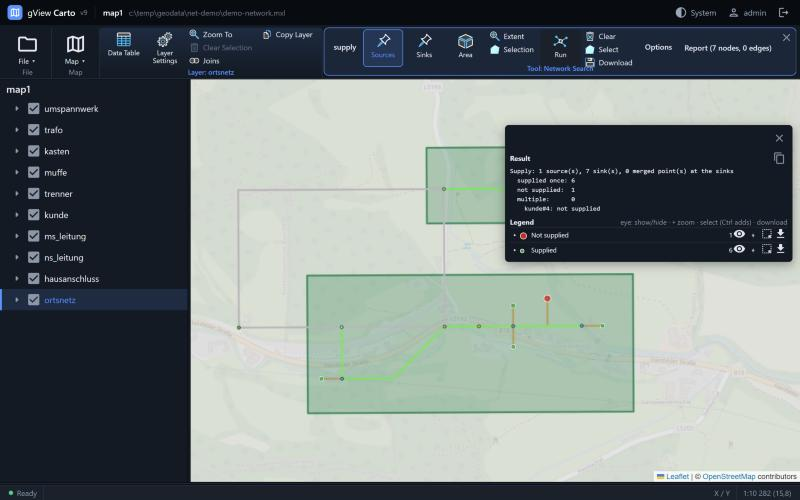
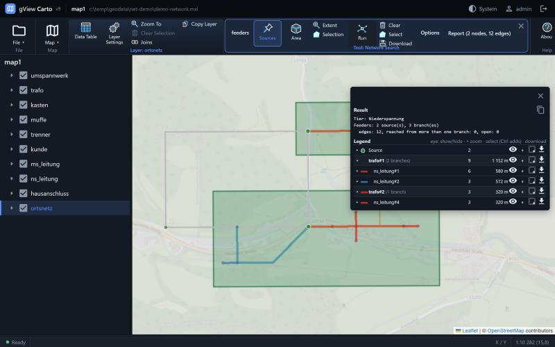
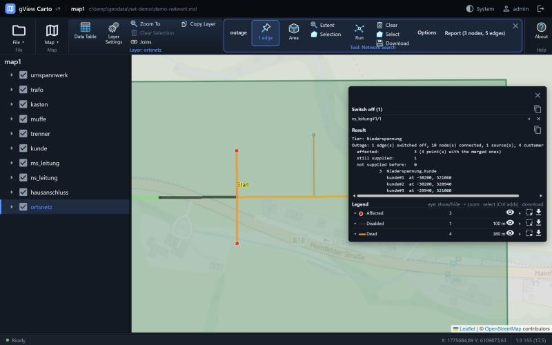
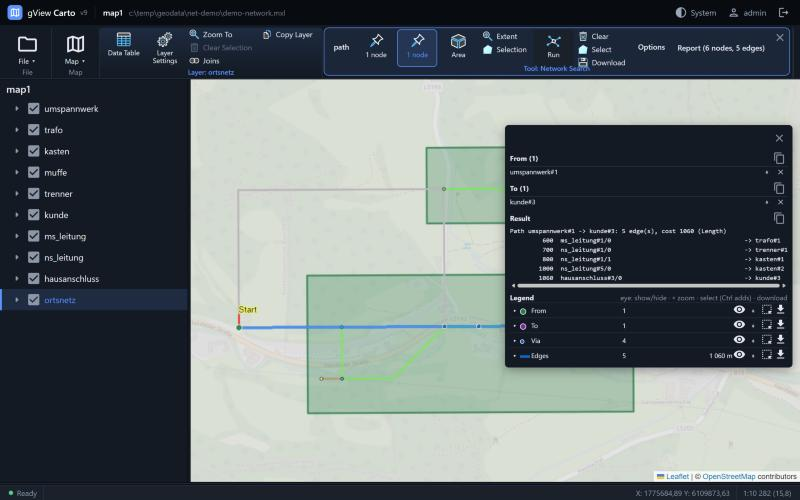
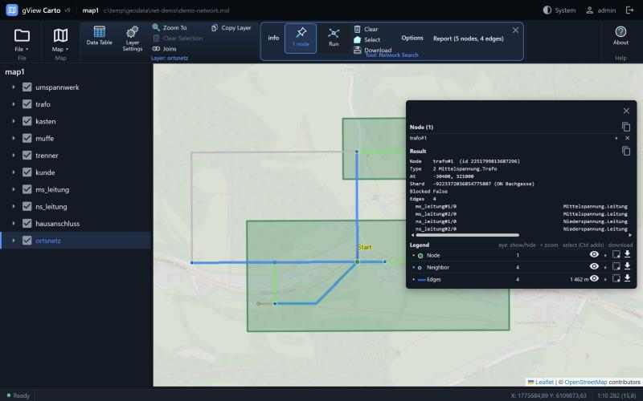
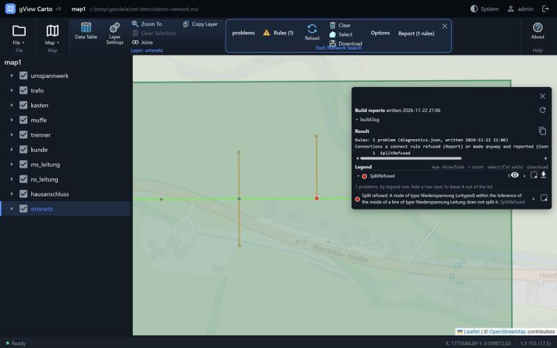

.. _carto-network-tools:

Network tools
=============

On a built network (see :ref:`carto-network`) the tool **Network Search** of *gView Carto* answers: what hangs on a node,
which way is the shortest, who is supplied, what fails, which transformer and which outlet feed a line, and where the
build reported problems. The examples use the sample network of :ref:`carto-network`.

The tool
--------

**Network Search** is in the toolbar under **Tools**. It opens its own bar:

* on the left the **operation** (here *trace*),
* next to it the buttons to click in the map, depending on the operation **Start**, **From**/**To**, **Sources**/**Sinks** or
  **Switch off**. A click in the map takes the nearest node; the button then shows the count (e.g. *1 node*),
* **Area** limits the search to an area: **Extent** takes the map extent, **Selection** the selected polygons. Edges across
  the border are not followed,
* **Run** starts the search,
* **Clear** removes the result, **Select** takes all found features as the selection of their layers, **Download** saves the
  result as GeoJSON,
* **Options** holds the other settings, **Report** opens the result window again.

When several nodes lie at the clicked place (e.g. a transformer in medium and in low voltage when the tiers are built
separately), the selected tier chooses the node; another click at the same place takes the next one.

Operations
----------

- **trace**: everything reachable from the start, up to blocked nodes (e.g. open switches).
- **reach**: like *trace*, but only up to a distance or cost (**Max. cost** under **Options**).
- **path**: the shortest way from **From** to **To**.
- **supply**: which sinks (e.g. customers) are reached from the sources (e.g. the substation)?
- **outage**: what fails when nodes or lines are switched off (**Switch off**)?
- **feeders**: from which source and over which outlet is each line fed?
- **info**: the data of a node and its edges.
- **validate**: checks the validation rules of the network (tab **Rules**).
- **problems**: shows what the build reported.

Options
-------

- **Tiers**: search only in these tiers (several possible, empty = all). With a tier its sources, sinks and blocked nodes
  apply, and a search stops at the sources of the tier.
- **Weight**, **Max. cost**: what the cost measures (length or a weight of the network) and where the search ends.
- **Edge types**: follow only edges of these types, e.g. ``[Niederspannung,*]``.
- **Blocked nodes**: additionally blocked nodes, e.g. ``[*,Trenner]`` or ``trenner#1``.
- **Edges switched off**: lines that are off for this search, e.g. ``ns_leitung#4``.
- **Download: snap line ends onto the nodes**: the lines in the GeoJSON end exactly on the nodes.

Depending on the operation there are more fields, for *feeders* e.g. **Sources**, **Branches**, **Show open edges**,
**Colours** and **Palette**.

Result and legend
-----------------

The result appears in the map and in the result window: at the top the picked nodes, below the report (**Result**, with a
copy button) and the **legend**. The legend shows each kind of the result (e.g. *Supplied*, *Not supplied*) with colour and
count. Per row:

- the **eye** hides and shows the kind in the map (kept when the same operation runs again),
- **+** zooms to the features,
- **select** takes the features as the selection of their layers; with **Ctrl** pressed they are added to the selection,
- **download** saves only this kind as GeoJSON.

Supply
~~~~~~

*supply* without picked sources takes the sources of the network (or of the tier). Here six customers are supplied
(green), ``kunde#4`` is not (red, larger): its service line ends on a cable without being connected. That is the T
junction of the sample that the build reported instead of connecting (see *problems* below). Customers supplied over more
than one way appear orange as *Multiple*.

Feeders: transformer and outlet
~~~~~~~~~~~~~~~~~~~~~~~~~~~~~~~

*feeders* colours each line by the outlet (or, under **Colours**, by the source) that feeds it. Without picked sources
these are the sources of the tier, in the picture the two transformers of the low voltage tier. **Branches** is a type
pattern for the edges at a source that start an outlet; empty, every edge at a source is one. The legend lists the outlets
per source with the number of lines and their length. Lines reached from more than one outlet (ring, double supply) are
red (*Multiple*); with **Show open edges** lines that no outlet went along (e.g. at a separation point) appear grey and
dashed (*Open*).

For a whole network and to write the result back into the data, use the pipe node **Network Trace**.

Outage
~~~~~~

*outage*: click a line or a node with **Switch off**, **Run**. Switched off (*Disabled*) is dark, the lines without supply
(*Dead*) are orange, the customers affected (*Affected*) red. The report lists them with coordinates.

Shortest path
~~~~~~~~~~~~~

*path*: click **From** and **To**, **Run**. The report lists the edges of the way with the summed up cost. The way does
not pass blocked nodes. In the sample it goes through ``trenner#1`` because no switching state is set for the switch
(Layer Settings, **Normal switching state**); **Blocked nodes** blocks it for one search.

Info
~~~~

*info* shows the id, type, coordinates and shard of a node, whether it is blocked, and all its edges with their types. Use
it to check whether a line is really connected to the node.

Build problems
~~~~~~~~~~~~~~

*problems* reads the reports of the last build (conflicts, notes, reports of the connect rules, duplicates, merged points)
and shows them as points in the map. Choose the category on the left; **Reload** reads the reports again after a new
build. A click on a row zooms to the problem, **Select** selects the features involved. The picture shows the reported T
junction of the sample (*SplitRefused*). **build.log** holds the log of the build.
