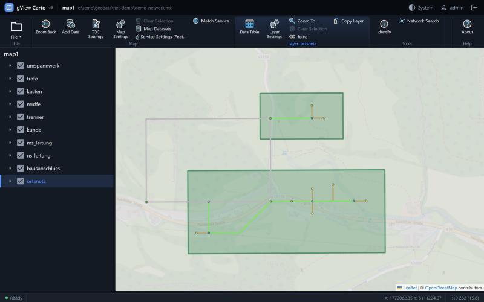
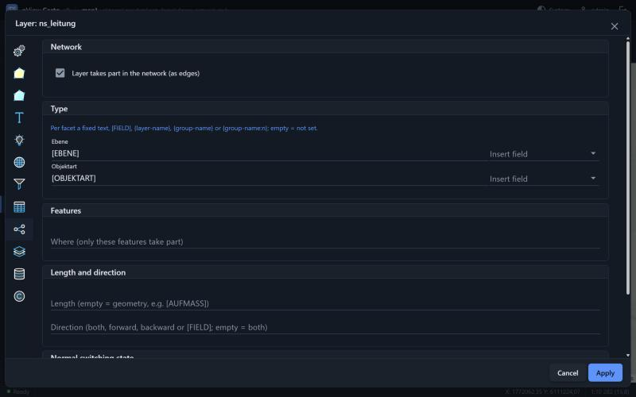
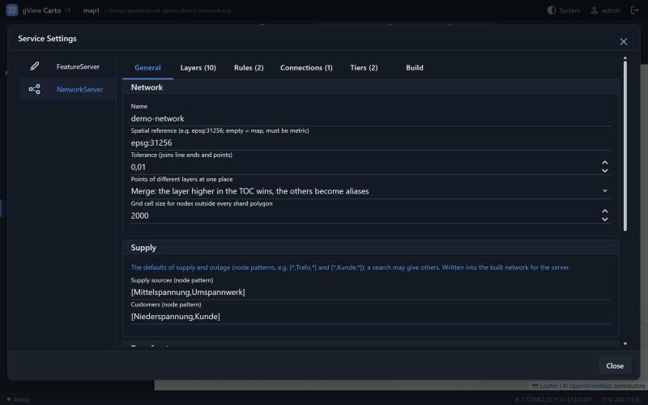
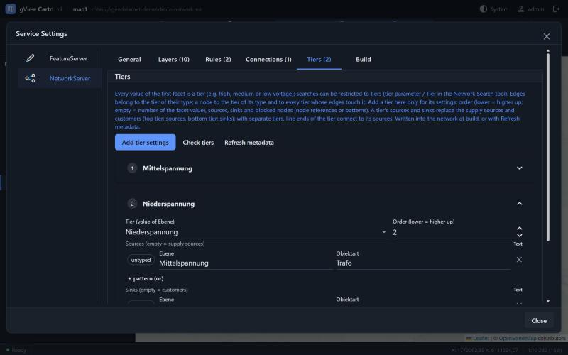
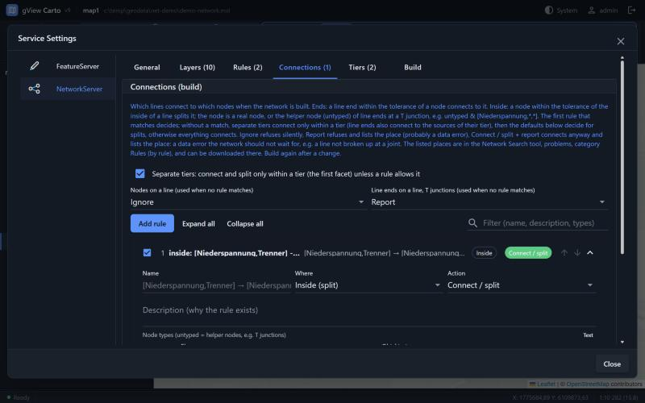
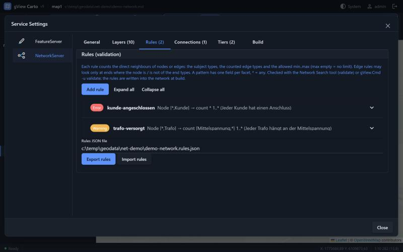
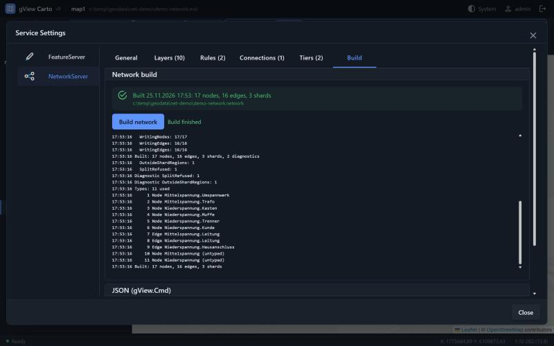
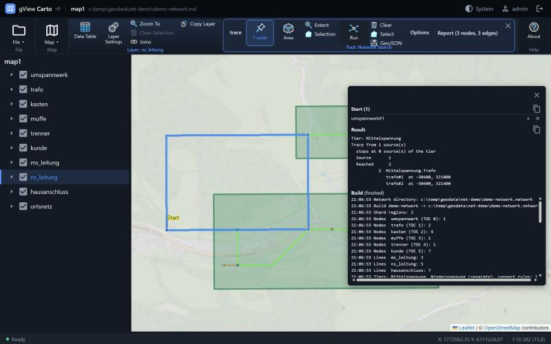

.. _carto-network:

Building networks
=================

From the point and line layers of a map, *gView Carto* builds a network: a graph of nodes and edges that the
**NetworkServer** of the service searches (trace, shortest path, supply, outage, rules). This page shows the steps in
Carto with a small sample network: a substation, three medium voltage cables, two transformers and behind them a low
voltage network with boxes, a switch, house connections and customers. The configuration in detail is described in
:ref:`network-service-administration`.

In the sample a low voltage joint lies on a vertex of a medium voltage cable, and a house connection ends on a low
voltage cable (a T junction). Both are common in real data when the tiers are kept by different departments; step 3
shows how to deal with them.

1. Add layers to the network
----------------------------

For every layer that belongs to the network: context menu of the layer, **Layer Settings**, page **Network**.

* **Layer takes part in the network**: point layers become nodes, line layers edges, a polygon layer may give the
  **shards** (e.g. local networks).
* **Type**: one template per facet that makes the type of every feature: a fixed text, a field ``[EBENE]``,
  ``{layer-name}``, ``{group-name}`` (the group of the layer) or ``{group-name:n}``. **The first facet is the tier**,
  e.g. medium or low voltage: with one group per tier in the table of contents, use ``{group-name}`` there.
* **Where**, length, direction and the normal switching state (e.g. a field whose value blocks a switch) are optional.

Alternatively **Service Settings**, **NetworkServer**, tab **Layers**, **Add all point and line layers** adds all layers at once.

2. Basic settings
-----------------

**Service Settings** (toolbar **Map**), **NetworkServer** on the left, tab **General**:

* **Spatial reference**: the metric spatial reference the network is built in (empty: the map's).
* **Tolerance**: line ends and points closer than this become one node (default 0.01).
* **Points of different layers at one place**: an error, or the layer higher in the table of contents wins and the others
  become aliases (e.g. a customer drawn on a box).
* **Supply**: the default sources and customers of supply and outage, as type patterns, e.g. ``[Mittelspannung,Umspannwerk]``.
* **Type facets** and **Weights**: the facets (tier, object type, …) and further weights beside the length.

3. Tiers and connections
------------------------

Every value of the first facet is a **tier**. On the tab **Tiers** a tier gets its settings: rank, sources, sinks and
blocked nodes. The sources of the low voltage are the transformers of the medium voltage.

The tab **Connections** decides what is connected and split at build:

* **Separate tiers**: connect and split only within a tier. The low voltage joint on the medium voltage cable no longer
  splits it; low voltage cables connect to the transformers because they are sources of their tier.
* **Nodes on a line**, **Line ends on a line (T junctions)**: what applies when no rule matches. In the sample no node
  splits a line (*Ignore*), T junctions are reported (*Report*).
* **Rules**: the first rule that matches wins. Here a low voltage switch may split a low voltage cable. Each rule is a
  panel with a header (check box = enabled, number, name, patterns, **Where** and **Action**); expanded it shows **Name**,
  **Description** (why the rule exists) and the patterns. The switch **untyped** of a row means the helper nodes (line ends
  without a point), e.g. for rules about T junctions; **Text** shows the pattern as text (``&`` and, ``!`` not). The arrows
  change the order, the filter field searches name, description and types.
* **Action**: *Connect / split* connects or splits, *Ignore* does not, *Report* does not and reports the place,
  *Connect / split + report* connects anyway and reports it (e.g. a line not broken up at a joint). The tool
  **Network Search** shows reported places with the operation *problems*, category **Rules**.

The fields of the patterns suggest the values of the facets. How the decision is made in detail is described in
:ref:`network-service-connect`.

4. Rules
--------

The tab **Rules** holds rules that find topology errors: a rule counts the direct neighbours of nodes or edges and compares
the count with min and max, optionally within one tier. The header shows severity (*Error*, *Warning*), name, patterns and
description; expand a rule to edit it. **Export rules**/**Import rules** exchange the rules as a JSON file.

Checks run with the tool **Network Search** (operation *validate*) or with ``gView.Cmd -u validate``, never at build: a rule
with an unknown tier does not stop the build, the log warns, and *validate* fails until it is fixed.

5. Build
--------

Tab **Build**, **Build network**. The map must be saved: the network is stored next to it (``{map}.network``). The log
shows the number of nodes, edges and shards, the notes (e.g. ``SplitRefused`` for the reported T junction,
``OutsideShardRegions`` for features outside the shard polygons) and the types used. ``conflicts.json`` in the network
directory lists conflicts when the build stops. All reports of the build can be viewed in the map with the tool
**Network Search**, operation *problems* (see :ref:`carto-network-tools`).

**JSON (gView.Cmd)** exports and imports the configuration, e.g. to build at night with ``gView.Cmd --command Network -u build``.

6. Search
---------

The tool **Network Search** (toolbar **Tools**) searches the built network: choose an operation (trace, reach, path,
supply, outage, feeders, info, validate, problems), click the start in the map with **Start**, **Run**. Under **Options**,
**Tiers** restricts the search to tiers; an **Area** limits it in space. All operations are described in
:ref:`carto-network-tools`.

The picture shows a trace from the substation on the medium voltage tier: it reaches both transformers, the low voltage
joint stays out. When several nodes lie at the clicked place (separate tiers), the tier chooses the node; another click at
the same place takes the next one.

7. Publish
----------

When the map is published as a service, the network is available as the **NetworkServer** of the service as soon as it
lies at the server's location (build in the server administration, gView.Cmd, or copied). Access, location and the REST
operations are described in :ref:`network-service-administration`.
