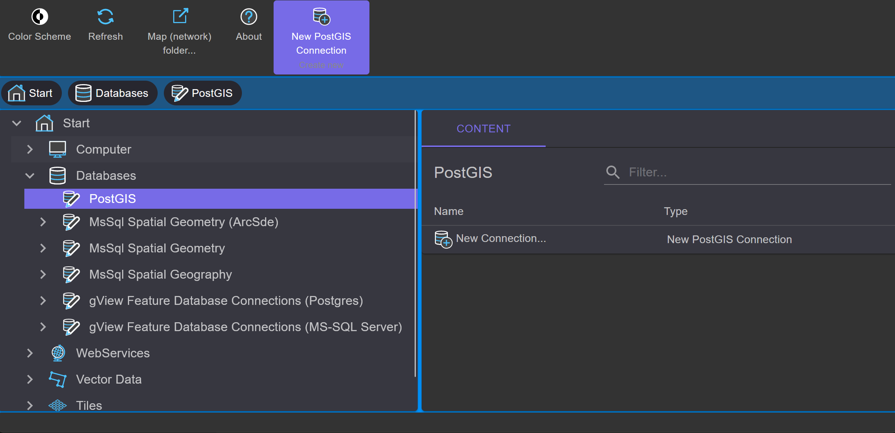
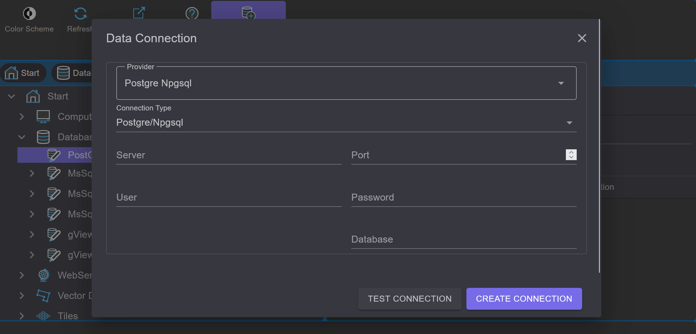

Database Connections
========================

With *gView.DataExplorer*, connections to geospatial data sources can be managed and the data can be 
visualized in a simple manner.

File-based data sources can be easily displayed by navigating to the respective directory in the filesystem.

For databases, connections must first be created. Here, an example is shown of how to establish a connection 
to a PostGIS database.

.. note::
   Connections created in *gView.DataExplorer* are also available in *gView.Carto* when inserting data.

PostGIS databases are integrated through the ``Databases`` node:

Under ``PostGIS``, all existing connections are listed. With ``New Connection``, a new connection can be created:

After entering the connection parameters, you can use ``Test Connection`` to verify whether a connection can be established 
before creating it. After confirming the dialog with ``OK``, the connection is established and appears in the list. 
A double-click on the connection opens it and lists the layers in the database.

Using the tools in the context area of the toolbar, a connection can be renamed or deleted. 
With the ``Connection String...`` button, the connection parameters can be modified afterwards.

.. note::
   When data is integrated via a database connection using *gView Carto*, all connection parameters are stored in the 
   MXL file. Changes made to the connection parameters in *gView DataExplorer* will not affect existing *gView Carto* 
   maps that have already been created.

.. _dataexplorer-cog:

Cloud Optimized GeoTIFF (COG) over HTTP
---------------------------------------

GeoTIFF and COG files on a web server or in object storage (S3, Azure Blob Storage) can be added directly by
their URL, without downloading them. Range requests read only the parts a map needs. The connections are under
``WebServices`` in the ``Cloud Optimized GeoTIFF (COG)`` node.

``New Connection...`` opens a dialog in which one or more URLs are entered, one per line. When the dialog is
confirmed with ``OK``, every URL is opened and checked: valid lines are shown with size, number of bands, overviews
and coordinate system, failing ones with the error message (e.g. file not found, not a GeoTIFF, server without
range support). The dialog closes only when all lines can be read. Every URL becomes a connection of its own;
its name is the file name, for equal file names with the folder before it (e.g. ``S2B_33UXP_20240824_0_L2A/TCI.tif``).

Using the tools in the context area, a connection can be renamed or deleted; ``URL`` changes the address, e.g. for
a renewed presigned URL. A connection can be added to a *gView Carto* map like a raster file; the MXL file stores
the URL like a file name.

.. note::
   Only GeoTIFF/COG is supported; other raster formats are rejected over HTTP. Timeout, retries and additional
   headers (e.g. an API key) are configured globally in the ``rasternet`` section (see :ref:`gView.Server configuration, rasternet section <config-rasternet>`).
   Protected files are added with presigned or SAS URLs.

Public COGs are suitable for trying it out, e.g. from the *Open Data* collections on AWS:

- Copernicus DEM (elevation model, Float32): ``https://copernicus-dem-30m.s3.amazonaws.com/Copernicus_DSM_COG_10_N47_00_E016_00_DEM/Copernicus_DSM_COG_10_N47_00_E016_00_DEM.tif``
- Sentinel-2 true color image (RGB): ``https://sentinel-cogs.s3.us-west-2.amazonaws.com/sentinel-s2-l2a-cogs/33/U/XP/2024/8/S2B_33UXP_20240824_0_L2A/TCI.tif``
